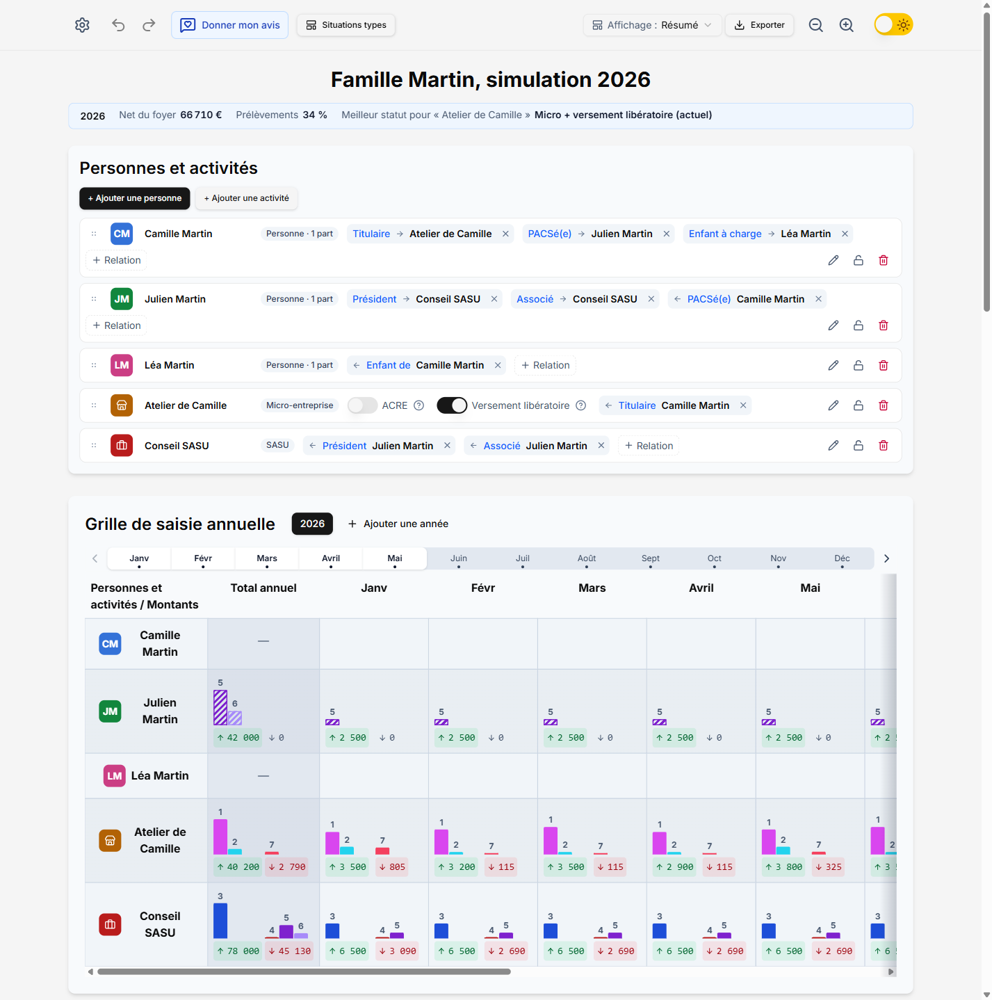
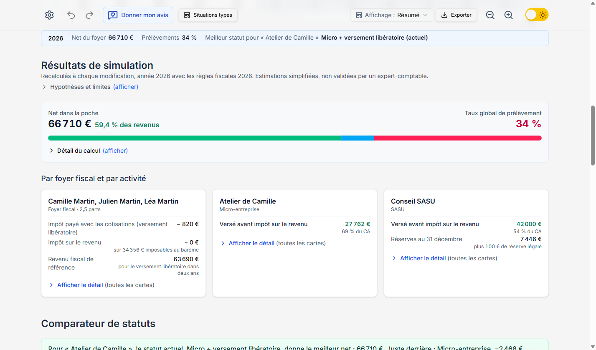
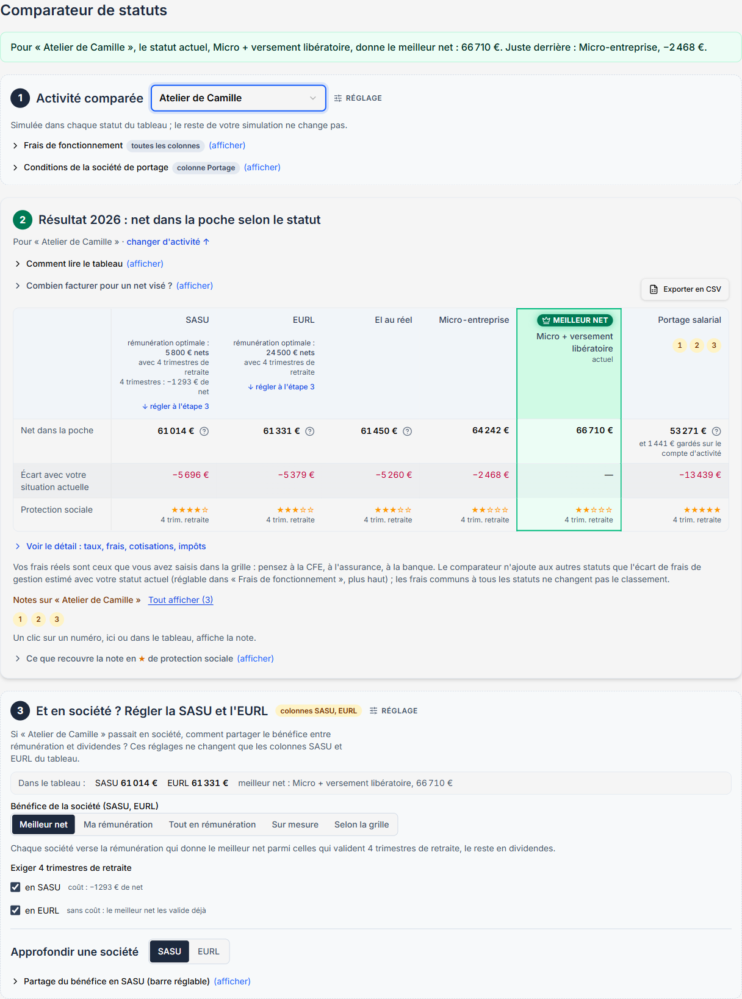
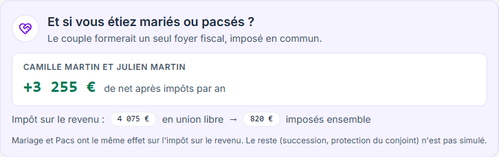
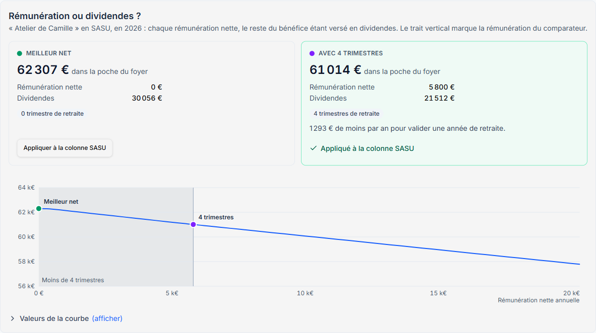

# Simulateur Indépendant FR (bêta)

[](https://github.com/DamienBecherini/simulateur-independant-fr/actions/workflows/ci.yml)
[](https://sonarcloud.io/summary/new_code?id=DamienBecherini_simulateur-independant-fr)
[](https://sonarcloud.io/summary/new_code?id=DamienBecherini_simulateur-independant-fr)
[](./LICENSE)
[](https://damienbecherini.github.io/simulateur-independant-fr/)
[](https://github.com/DamienBecherini/simulateur-independant-fr/issues?q=label%3Aretour)

**Vous êtes indépendant ? Combien vous restera-t-il vraiment à la fin de l'année, selon votre statut ?**

Un simulateur gratuit, hors ligne et open source, pour vous et votre foyer.

1. **Ma situation** : décrivez les personnes du foyer, vos activités (micro-entreprise, entreprise individuelle, EURL, SASU) et leurs liens, puis vos revenus et charges mois par mois.
2. **Mes résultats** : cotisations de chaque activité, impôt sur le revenu du foyer, net dans la poche et taux de prélèvement, recalculés à chaque modification.
3. **Comparer et optimiser** : la même activité en SASU, EURL, EI au réel, micro-entreprise (avec ou sans versement libératoire) et portage salarial, puis le partage entre rémunération et dividendes qui donne le meilleur net, et, pour un couple en union libre, ce que changerait un mariage ou un PACS.

> [!TIP]
> 🔒 **Vos données restent sur votre poste** : ni compte, ni serveur, ni mesure d'audience.

*Projet personnel, né d'un besoin d'entrepreneur. Je le partage pour montrer mes standards de code et ma vision produit, et parce qu'il peut aider d'autres entrepreneurs à y voir plus clair. Ce n'est pas un logiciel de conseil fiscal : les résultats sont indicatifs et n'ont pas été validés par un expert-comptable.*

## ▶️ Essayer en ligne

**[Ouvrir la démo](https://damienbecherini.github.io/simulateur-independant-fr/)**, sans installation ni compte. La même interface que l'application : le calcul se fait dans le navigateur et les simulations restent sur votre poste. Dans Chrome ou Edge, elle s'installe comme une application (« Comment faire ? » dans son bandeau) et fonctionne ensuite hors ligne : c'est la solution quand Windows bloque l'application de bureau téléchargée depuis GitHub, qui n'est pas signée ([pas à pas](./documentation/installation.md#si-windows-bloque-lapplication)).

## 📥 Télécharger

**Sous Windows, le plus simple : [installer depuis le Microsoft Store](https://apps.microsoft.com/detail/9PJBJWX5WS72)**. Le paquet est signé par Microsoft : il passe le Contrôle intelligent des applications et SmartScreen sans avertissement, et le Store le met à jour.

L'application de bureau pour Windows, macOS (Apple Silicon et Intel) et Linux se télécharge aussi depuis la **[dernière version publiée](https://github.com/DamienBecherini/simulateur-independant-fr/releases/latest)**. Ces exécutables ne sont pas signés par un certificat d'éditeur : Windows et macOS affichent un avertissement au premier lancement. Le [guide d'installation](./documentation/installation.md) explique comment le passer, système par système. Si le Contrôle intelligent des applications de Windows 11 la bloque, installez-la depuis le Microsoft Store, ou la démo web depuis Edge ou Chrome : voir [Si Windows bloque l'application](./documentation/installation.md#si-windows-bloque-lapplication). Les changements de chaque version sont dans le [journal des modifications](./CHANGELOG.md).

## 🖼️ Aperçu

Simulation fictive : une indépendante en micro-entreprise mixte, pacsée avec le président d'une SASU, avec un enfant.

| Acteurs et relations | Résultats du foyer |
|---|---|
|  |  |



Le même foyer en union libre : le comparateur dit ce que changerait un mariage ou un PACS.





## ✨ Ce que vous pouvez faire

**Décrire votre situation**

- Tout le foyer : couple marié, pacsé ou en union libre, enfants à charge, et les activités de chacun.
- Les statuts courants : micro-entreprise (avec ou sans versement libératoire), entreprise individuelle au réel, EURL, SASU.
- Une grille mois par mois pour les revenus et les charges ; un loyer ou un salaire se recopie sur toute l'année en un clic.
- Des situations types prêtes à adapter (SASU sans salaire, couple, ostéopathe…), expliquées et sourcées.

**Comprendre le résultat**

- Le net dans la poche du foyer et le taux de prélèvement, recalculés à chaque saisie.
- Le détail : cotisations de chaque activité, impôt du foyer, et une alerte quand un plafond est dépassé.
- Plusieurs années à la suite, chacune avec ses règles fiscales (2024 à 2026).

**Comparer et décider**

- Votre activité dans chaque statut, portage salarial compris, côte à côte, avec le meilleur net mis en évidence et la protection sociale de chacun.
- Rémunération ou dividendes : la répartition qui donne le meilleur net, avec ou sans 4 trimestres de retraite validés.
- Combien facturer pour toucher le net que vous visez.
- Mariage ou PACS : ce que ça change à l'impôt d'un couple.

**Et aussi**

- Professions libérales réglementées (CIPAV, CARPIMKO), frais réels et kilométriques, zone franche urbaine.
- Sauvegardes nommées, annuler et rétablir, sauvegarde automatique.
- Exports PDF, Excel (CSV), et un rapport à lire ou à confier à une IA.
- Avec une IA de bureau (une IA locale est recommandée : vos données sont sensibles), qui lit vos factures et propose les montants : vous validez chaque ajout, ou la laissez modifier directement la simulation (sauf suppression).
- Thème clair ou sombre, interface agrandissable, utilisable au clavier et avec un lecteur d'écran.

[Toutes les fonctionnalités, en détail](./documentation/fonctionnalites.md)

## ⚠️ Limites connues

La même liste est affichée dans l'application (« Hypothèses et limites », sous le titre des résultats) et reprise dans le rapport Markdown ; elle vient de `src/lib/limites-du-modele.ts`, et un test vérifie que cette section la recopie mot pour mot.

- Résultats indicatifs, non validés par un expert-comptable : ce n'est pas un conseil fiscal.
- Montants annuels en euros, hors taxe ; la grille saisit des montants mensuels, additionnés sur l'année.
- Cotisations d'un travailleur non salarié au réel (entrepreneur individuel, gérant d'EURL) calculées sur le revenu de l'année, comme après la régularisation : les acomptes provisionnels que l'Urssaf appelle d'abord sur un revenu antérieur, et la régularisation de l'année suivante, ne sont pas simulés ; l'appel de l'Urssaf d'une année peut donc différer du montant affiché.
- Cotisations des travailleurs non salariés calculées ligne à ligne selon le barème de l'année des artisans, commerçants et professions libérales non réglementées (assiette unique après l'abattement forfaitaire, assiettes minimales) ; la formation professionnelle d'un artisan est comptée au taux des commerçants, et la CSG déductible sur les dividendes soumis à cotisations n'est pas modélisée.
- Professions libérales réglementées : seules la CIPAV et la CARPIMKO sont calculées (au réel et en micro-entreprise) ; les autres caisses (CARMF, CARCDSF, CNBF…) le sont comme une profession non réglementée, avec un avertissement. CARPIMKO : retraite complémentaire et ASV calculées sur le revenu de l'année précédente quand elle est dans la simulation, sinon sur celui de l'année. En SASU ou en EURL, la rémunération d'un associé de société d'exercice libéral (BNC, caisse de la profession) n'est pas modélisée : un avertissement le signale.
- Président de SASU et salariés : cotisations calculées ligne à ligne avec les taux du régime général de l'année (président sans assurance chômage ni réduction générale, salarié avec la réduction générale) ; ne sont pas modélisés l'APEC des cadres, le régime d'Alsace-Moselle, le temps partiel, ni plus d'un employeur par personne ; le taux d'accident du travail retenu est celui des fonctions support.
- Portage salarial (colonne du comparateur) : bulletin annuel d'un cadre, aux conditions réglées de la société de portage (valeurs typiques à défaut) ; prestations de services seulement ; réserve d'un CDI montrée conservée chaque année ; ni périodes sans mission, ni mutuelle patronale, ni prévoyance au-delà du minimum des cadres ; une activité déjà en portage n'est pas encore comparée.
- Micro-entreprise : cotisations au taux de chaque nature d'activité, plus la contribution à la formation professionnelle, comptée au taux des artisans pour les prestations de services BIC (artisan et commerçant ne sont pas distingués).
- La note de protection sociale du comparateur est indicative (régime et trimestres de retraite validés) ; l'arbitrage rémunération / dividendes porte sur une seule année, sans les droits à la retraite complémentaire ni le lissage sur plusieurs années.
- Non modélisés : prévoyance et mutuelle, réductions et crédits d'impôt, résidence alternée, report sur les années suivantes du déficit d'une entreprise individuelle supérieur aux autres revenus du foyer (celui d'une société à l'IS est reporté), TVA (seul le dépassement des seuils de franchise est signalé ; les soins exonérés des professions de santé n'y comptent pas, et tout le chiffre d'affaires BNC de leur micro-entreprise est tenu pour des soins), répartition du capital entre associés (dividendes partagés à parts égales).

## 📖 Guides

- [Installer l'application](./documentation/installation.md), système par système, et que faire si Windows la bloque
- [Utiliser le simulateur avec une IA (serveur MCP local)](./documentation/utiliser-avec-une-ia.md)
- [Liens vers les situations types](./documentation/liens-vers-les-situations-types.md) : adresses de la démo web qui ouvrent une situation type
- [Toutes les fonctionnalités, en détail](./documentation/fonctionnalites.md)
- [Journal des modifications](./CHANGELOG.md)
- [Mentions légales et confidentialité](./documentation/mentions-legales.md)

---

## 🧑‍💻 Pour les développeurs

Le code, ses choix techniques et la façon de contribuer.

### 🚀 Démarrage rapide

Prérequis : Node.js 22 ou supérieur, npm.

```sh
git clone https://github.com/DamienBecherini/simulateur-independant-fr.git
cd simulateur-independant-fr
npm install
npm run dev
```

`npm run dev` lance Vite et Electron avec rechargement à chaud. Pour un exécutable : `npm run dist:win`, `npm run dist:mac` ou `npm run dist:linux`.

`npm run dev:web` lance la version navigateur (http://localhost:3524/simulateur-independant-fr/) ; `npm run build:web` la compile dans `dist-web/`.

Pour contribuer : `git config core.hooksPath .githooks` (une fois par clone) active les crochets git du dépôt, qui refusent un commit directement sur `main` ([`.githooks/README.md`](.githooks/README.md)).

### 🛠️ Stack technique

- **Application :** Electron (process principal Node.js, IPC typé via `contextBridge`).
- **Interface :** React 19, hooks maison (historique undo/redo, sauvegarde debounced).
- **Typage & validation :** TypeScript strict, Zod comme source de vérité unique.
- **Design system :** Tailwind CSS v4, ShadCN/UI, Lucide, dnd-kit, AutoAnimate (listes animées).
- **Build :** Vite, electron-builder.

### 🗂️ Structure du projet

- `documentation/` : guide du développeur et ADR.
- `src/backend/` : process principal Electron (accès fichiers, IPC), serveur MCP et, dans `src/backend/logic/`, le moteur de calcul pur, partagé avec l'interface et la démo web (carte des modules dans le [guide du développeur](./documentation/GUIDE_DEVELOPPEUR.md#23-où-vit-quoi--carte-du-moteur)).
- `src/ui/` : application React (composants, hooks, interface).
- `src/lib/` : fonctions utilitaires et logique pure partagée.
- `src/web/` : démo web, qui remplace le process Electron : même `window.api`, moteur exécuté dans la page, stockage dans le navigateur. `src/web/pwa/` la rend installable et utilisable hors ligne (manifeste, service worker écrit à la main, compilé par `vite-plugin-demo-installable.ts` : voir l'[ADR 012](./documentation/adr/012-demo-web-installable-hors-ligne.md)).
- `src/types.ts` : schémas Zod et types centraux.
- `scripts/retours/` : scripts Node des retours des utilisateurs, lancés par les workflows GitHub. `etiqueter.mjs` pose les étiquettes d'un ticket du formulaire `.github/ISSUE_TEMPLATE/retour.yml` (`note-1` à `note-5`, `affichage-resume`, `affichage-classique`, `affichage-vues`, `avis`, `bug`, `idee`) ; `agreger.mjs` écrit à chaque publication de la démo le fichier `retours.json` (`nombreDeNotes`, `moyenne` au dixième, `preferencesAffichage`, `misAJour`, et `resume`, le texte du badge : « 4,2/5 (12 notes) » ou « pas encore de note »). Les retours sans note n'entrent pas dans la moyenne ; chaque compte GitHub n'y compte qu'une fois, par son ticket le plus récent qui donne une note (de même pour l'affichage préféré), et les tickets étiquetés `invalide` ou `spam` sont écartés.

### ✨ Points d'intérêt dans le code

- `src/backend/logic/simulation-engine.ts` : moteur de simulation à sens unique (activités → revenus des personnes → impôt du foyer), point d'entrée d'une année ; les étapes sont dans `routage-des-flux.ts`, `simulation-au-reel.ts`, `simulation-micro.ts`, `details-des-activites.ts`, `impot-du-foyer.ts` et `bilan-de-la-simulation.ts`.
- `src/backend/logic/foyers.ts` : regroupement des foyers fiscaux par union-find (couples, enfants rattachés, parts).
- `src/backend/logic/regles.ts` + `src/backend/regles/<année>.json` : les règles fiscales et sociales, un fichier par année (liste dans `src/backend/regles/index.ts`), typées et sourcées, hors du code. L'année en cours du simulateur est la plus récente de ces années.
- `src/backend/logic/data-sanitizer.ts` : validation et réparation des sessions (relations et flux orphelins).
- `src/backend/logic/optimisation-remuneration.ts` : arbitrage rémunération / dividendes, par balayage puis affinage autour des optimums.
- `src/backend/util.ts` + `src/backend/preload.cts` : contrat IPC typé de bout en bout, sans `any` sur la surface exposée.
- `src/types.ts` : schémas Zod et types dérivés.
- `src/ui/hooks/useSessionManager.ts` : état de session, historique, sauvegarde asynchrone.
- `src/lib/business-logic.ts` : nettoyage du graphe lors de la rupture d'une relation.

### ✅ Qualité

```sh
npm test               # rapide : tests de la logique et des composants (Vitest)
npm run test:watch     # tests en mode interactif
npm run test:coverage  # tests + couverture (v8), rapport dans coverage/
npm run test:e2e       # compile l'application, puis tests de bout en bout (Playwright + Electron), fenêtres masquées
npm run test:e2e:visible  # les mêmes, fenêtres affichées pour suivre les tests
npm run test:web       # compile la démo web, puis la teste dans Chromium (Playwright)
npm run test:web:firefox  # la même série dans Firefox (npm run installer:firefox une première fois)
npm run test:all       # tout : tests avec couverture, puis tests de bout en bout (application et démo web)
npm run verifier       # avant une fusion : ce que vérifie la CI, en 6 à 10 minutes sur un poste récent
npm run lint           # ESLint, dont la complexité cyclomatique
npm run duplication    # détection de code dupliqué (jscpd)
npm run test:mutation  # tests de mutation (Stryker), rapport dans reports/mutation/
```

- **Tests** : fichiers `*.test.ts` placés à côté du code testé ; le moteur est testé avec des règles fictives aux chiffres ronds (`src/backend/logic/testing/`), pour que les montants attendus se vérifient de tête et ne dépendent pas du barème de l'année.
- **Cas de référence 2026** : `src/backend/logic/references/` fait tourner le moteur avec les règles réelles de 2026 sur une soixantaine de situations (micro-entreprise, SASU, EURL, EI, salaires, familles, comparateur), dont chaque montant attendu est dérivé à la main des règles officielles. Ils sont liés à 2026 pour toujours, comme les situations types : l'ajout des règles d'une année plus récente ne les désactive pas et ne change pas leurs chiffres (un test le vérifie avec une année fictive).
- **Valeurs limites** : chaque seuil est testé pile dessus et un euro au-delà (plafonds et TVA de la micro, revenu fiscal de référence du versement libératoire, 4 trimestres, plafond de la sécurité sociale, 3 SMIC de la réduction générale, dividendes d'EURL à 10 % du capital), ainsi que les noms hostiles dans les exports (séparateurs, retours à la ligne, formules), les fichiers retouchés à la main et les séries de flux en bord d'année.
- **Tests de composants** : fichiers `*.test.tsx` (React Testing Library, user-event, jsdom) qui rejouent les parcours de saisie au clavier, la fenêtre des flux, les cartes d'entités, les résultats et l'historique d'annulation ; `window.api` y est simulé (`src/ui/testing/`).
- **Tests de bout en bout** (optionnels) : fichiers `e2e/*.e2e.ts`, où Playwright pilote l'application Electron compilée (création d'entités, saisie dans la grille, résultats, historique, sauvegarde automatique, conversion d'un ancien format, sauvegardes nommées). Chaque test lance l'application sur un dossier de données temporaire (`--user-data-dir`), sans toucher aux vraies données ; aucun navigateur à télécharger. En intégration continue, ils tournent sur `integration`, sur `main` et à la demande.
- **Démo web** : `e2e-web/*.web.ts` ouvre la version navigateur compilée dans Chromium (simulation d'exemple, calculs, conservation des modifications, retour à l'exemple ; manifeste, installabilité relevée par Chromium, réouverture et calcul hors ligne dans `installable.web.ts`, seul fichier où le service worker n'est pas bloqué). Elle nécessite une fois `npm run installer:chromium`. Les fichiers de mise en page sont aussi joués dans Firefox (`npm run test:web:firefox:mise-en-page`), sur `integration` et `main`. À chaque push sur `main`, la CI la teste puis la publie sur GitHub Pages.
- **Accessibilité (WCAG 2.2 AA, qui couvre le RGAA)** : audit axe-core de la démo web et de l'application dans les tests de bout en bout (chargement, comparateur déplié, mode sombre, téléphone, fenêtres), bloquant en CI ; tests dédiés des zones cliquables (24 px, 44 px sur écran tactile), des tailles de texte (12 px au moins, 14 px pour les phrases), du parcours au clavier avec focus visible et du curseur.
- **Couverture** : seuil bloquant de 90 % (instructions, branches, fonctions, lignes) sur la logique pure : `src/backend/logic/`, `src/lib/`, le serveur MCP, le pont de la démo web et les scripts (`vitest.config.ts`).
- **Complexité** : règle ESLint `complexity` plafonnée à 12 sur `src/`, sans exception.
- **Mutation** : Stryker sur les modules de `src/backend/logic/` (hors sous-dossiers) (score d'environ 86 %), lancé chaque semaine et à la demande ; nécessite Node.js 22 ou supérieur.
- **Intégration continue** : GitHub Actions exécute lint, vérification des types, tests avec couverture et build à chaque push et pull request.
- **SonarQube Cloud** (facultatif) : quand le secret `SONAR_TOKEN` est configuré, la CI envoie le code et la couverture à SonarQube Cloud (`sonar-project.properties`) et attend le verdict de la porte qualité : une porte rouge fait échouer le job, exigé sur `main` ; sinon, elle se contente de la détection de code dupliqué.
- **Captures d'écran** : celles du README et de la fiche du Microsoft Store sont générées par `npm run captures` (Playwright, sur l'application compilée).

### 🤖 Développement assisté par IA

Le projet est développé avec des agents IA qui travaillent directement dans le dépôt, sous relecture humaine. Leurs modifications passent par les mêmes garde-fous que le reste du code : tests, cas de référence, lint, vérification des types et intégration continue.

### 📚 Documentation technique

- [Guide du développeur](./documentation/GUIDE_DEVELOPPEUR.md) : prise en main, architecture, procédures pas à pas (nouvelle année de règles, nouvelle caisse, format de fichier, cas de référence, débogage d'un calcul…), sources officielles et glossaire
- [Décisions d'architecture (ADR)](./documentation/adr/)
- [Roadmap itérative](./Roadmap.md)
- [Cahier des charges & architecture globale](./Cahier%20des%20charges.md)

## 📄 Licence

[MIT](./LICENSE) © 2025-2026 Damien Becherini.
